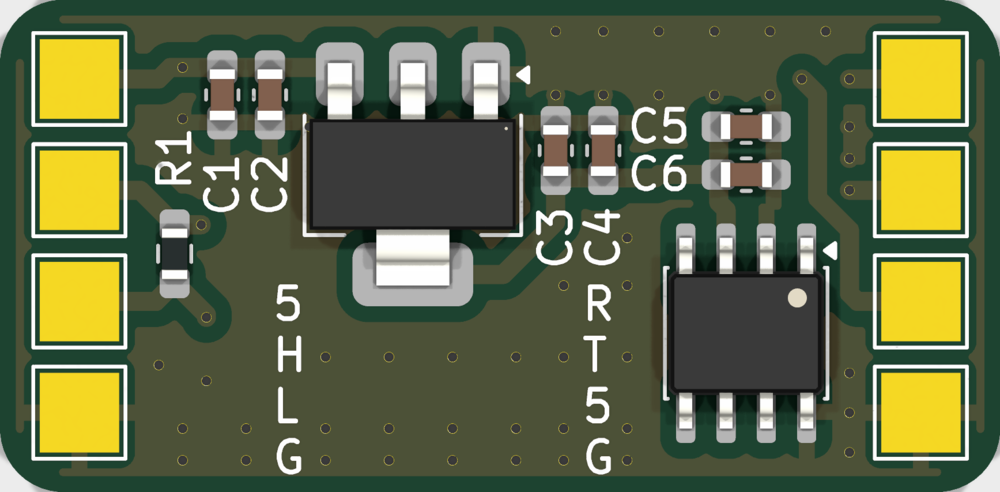
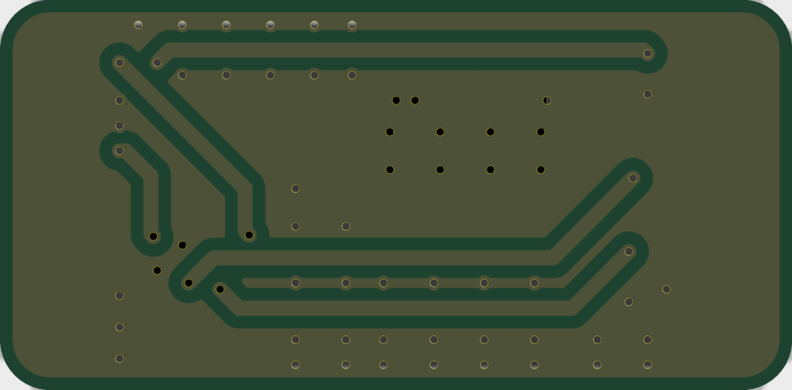

# SimpleCANBreakout

A small (31.5 × 15.5 mm) CAN transceiver breakout. It converts a microcontroller's logic-level CAN TX/RX to a CAN bus, with an onboard 3.3 V regulator and 120 Ω termination. All connections are large solder pads, so wires can be soldered directly to the board.

 

Designed in KiCad 10. See [SimpleCANBreakoutMicro](https://github.com/jlpoltrack/SimpleCANBreakoutMicro) for a smaller version with a JST-GH connector, an XC6206 regulator, and switchable termination.

## Features

- SN65HVD230 3.3 V CAN transceiver, wired for high-speed mode (up to 1 Mbps)
- AMS1117 3.3 V LDO, so the board runs from a single 5 V supply
- 120 Ω termination resistor, always fitted
- 2-layer, 1.6 mm PCB, parts on the top side only
- All parts are JLCPCB basic parts, except U1 (preferred extended)

## Connections

All pads are 2.5 × 2.5 mm, labelled on the silkscreen.

**MCU side** (right column, top to bottom)

| Pad | Silk | Signal |
|-----|------|--------|
| TP8 | R    | CAN RX |
| TP7 | T    | CAN TX |
| TP5 | 5    | +5V    |
| TP6 | G    | GND    |

**CAN bus side** (left column, top to bottom)

| Pad | Silk | Signal |
|-----|------|--------|
| TP3 | 5    | +5V    |
| TP1 | H    | CANH   |
| TP2 | L    | CANL   |
| TP4 | G    | GND    |

The +5V pads on both sides are connected, so the board can be powered from either side. CAN TX/RX are 3.3 V logic.

## Termination

R1 (120 Ω) is permanently connected across CANH/CANL, so the board is meant to sit at an end of the bus. Leave R1 unpopulated if the board is used mid-bus.

## Bill of materials

| Ref        | Value       | Package  | LCSC   |
|------------|-------------|----------|--------|
| U1         | SN65HVD230  | SOIC-8   | C12084 |
| U2         | AMS1117-3.3 | SOT-223  | C6186  |
| C1, C4, C6 | 10 µF       | 0603     | C19702 |
| C2, C3, C5 | 100 nF      | 0603     | C14663 |
| R1         | 120 Ω       | 0603     | C22787 |

## Files

- `SimpleCANBreakout.kicad_sch` / `.kicad_pcb` / `.kicad_pro` — KiCad project
- `SimpleCANBreakout.pdf` — schematic
- `production/` — fabrication outputs generated with the [Fabrication Toolkit](https://github.com/bennymeg/Fabrication-Toolkit) plugin: Gerbers and drill files (`SimpleCANBreakout.zip`), BOM, and pick-and-place positions, ready for JLCPCB

## License

[MIT](LICENSE)
